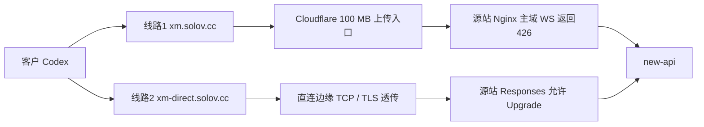

# Codex 413 与 WebSocket：现场结论、处置方案与验收

审查时间：2026-10-28（北京时间）。本页是只读调查和修复建议，未改服务器源码、配置或运行状态，未发送模型请求。截图来自另一台客户电脑，不能用审查电脑的 Codex 配置代替客户配置。

## 已确认的结论

**截图两次 413 均由 Cloudflare 边缘返回，没有转发到源站。两次实际请求都是 HTTP POST，没有通过 WebSocket。主域存在明确的 WebSocket 426 拒绝规则；直连线路则有真实的 101 升级成功记录。**

用户只输入“在吗”不能说明整个请求很小：Codex 可能同时提交会话历史和图片。此次日志没有保留完整请求体，不能断言是某张图片、某条工具输出或具体多少 MB 导致。

## 精确事故证据

按截图中两条完整 CF-Ray 精确查询 Cloudflare HTTP 请求数据，以下仅公开遮盖后的标识。原始标识、客户 IP、凭据和业务请求体不入仓。

| 请求 | 北京时间 | host / method / path | edge status | origin status / IP |
|---|---|---|---:|---|
| Ray `a512e016…-NRT` | 2026-10-27 23:53:44 | `xm.solov.cc` / POST / `/v1/responses` | 413 | 0 / 空 |
| Ray `a512e19c…-NRT` | 2026-10-27 23:54:47 | 同上 | 413 | 0 / 空 |

两条协议均为 HTTP/1.1；UA 为 Codex Desktop `0.163.0-alpha.11`、桌面构建 `26.1016.51333`、macOS 15.2 arm64。CF 返回页面与截图的 Cloudflare HTML 一致；当前 zone 没有 Workers 路由。以上共同支持边缘直接拒绝，不能归因于 new-api 请求体解析器或源站 Nginx。

`edgeRequestBytes=0` 是这两条记录的不完整指标，**不等于实际请求体为 0，也不能据此还原具体大小**。当前 Free zone 的 `max_upload=100`，WebSockets 开关已经打开；这符合 Cloudflare Free/Pro 100 MB 上传限制。当前配置值不等于有故障时点的配置审计快照。[Cloudflare 413 文档](https://developers.cloudflare.com/support/troubleshooting/http-status-codes/4xx-client-error/error-413/)

源站入口日志未记录 CF-Ray，因此“在源站找不到 Ray 字符串”不能作为未到源站的证明。本次采用 CF 精确记录、时间、方法、客户端元数据和源站响应交叉确认，没有把字符串搜索无匹配当作证据。

## 同时存在的另一种失败：524 等待超时

相同 IP 与 UA 的 50 分钟查询窗口返回 51 条记录：33 条 413、17 条 200、1 条 524。它是查询窗口样本，不能当成该账号完整请求史；同 IP 与 UA 也不能证明所有请求属于同一登录账号。

其中另一次请求于北京时间 **23:54:25** 发起，CF 记录请求约 63.2 MB、最终 524；源站对应记录在 **23:56:30** 结束，接收约 63.2 MB、耗时 **125.010 秒**、返回 **499**，未发送响应体。这一请求已经过上传入口，后续等待触发 Cloudflare 超时、源站看到连接被断开。它与截图中两次 413 是不同请求，不能合并成同一原因。

Cloudflare 当前文档的默认 Proxy Read Timeout 为 125 秒。源站把超时设为 900 秒并不能延长前面的 Cloudflare 等待时间。[Cloudflare 524 文档](https://developers.cloudflare.com/support/troubleshooting/http-status-codes/cloudflare-5xx-errors/error-524/)

## WebSocket 是否真的生效

| 层次 | 已核实的事实 | 不能推出的结论 |
|---|---|---|
| CF zone | `websockets=on` | 不能保证后面的 Nginx 接受 Upgrade |
| 主域入口 | `GET:/v1/responses:websocket` 命中明确的 `return 426` 规则 | 配置 `supports_websockets=true` 仍可能回退 HTTP |
| 故障附近主域日志 | 23:48、00:03:45 有 GET 426、耗时 0、无上游响应时间 | 这些是其他请求，不能说是客户先试了 WS |
| 截图客户的两条记录 | POST HTTP/1.1 413 | 只能证明这两条没用 WS，不能反推其全部配置 |
| 直连入口已有日志 | 最后 20,000 行中，Responses GET 有 393 条 `status=101` 且 `upstream_status=101` | 证明真实升级成功，不证明客户这次用了直连或每个生成任务都完成 |

直连样本还有 35 条 401 和 26 条 502，不能把 393 次升级写成“全链路无失败”。

与客户 UA 对应的 Codex `rust-v0.163.0-alpha.11` 源码中，`StatusCode::UPGRADE_REQUIRED` 返回 `FallbackToHttp`，`try_switch_fallback_transport` 会在该 Codex 会话中停用 WS；后续可能持续走 HTTP。旧报告引用的 0.164.0 仅作历史参考，此处已按实际 UA 的 tag 校正。[对应版本 client.rs](https://github.com/openai/codex/blob/rust-v0.163.0-alpha.11/codex-rs/core/src/client.rs)

WS 增量机制也有边界：缓存有效时可沿用前一响应并发送新增输入；首次连接、缓存丢失或重建会话仍可能需要完整上下文。它不是无限请求体通道。[OpenAI WebSocket mode](https://developers.openai.com/api/docs/guides/websocket-mode)

## 当前线路结构和限制

当前只读配置核验：主域 Nginx body 512m、Responses 900s；直连 Responses location body 256m、900s；new-api 容器显式 `MAX_REQUEST_BODY_MB=256`、镜像 `v1.0.0-rc.46`。直连边缘为 TCP/TLS 透传，不是另一层 HTTP 请求体解析器。名为 `reqlog_newapi` 的 upstream 实际直接转到 new-api 的本地端口，不能仅凭名称推断还有一个限额代理。

当前源站 worker 与容器在两次 413 **之后**启动，因此这些当前值只用于解释现有链路和处置，不冒充故障当时的完整运行配置。主域 426 文件早于故障，且故障附近已有真实 426 日志，规则当时实际生效有额外证据支持。

## 可以怎样解决（本 PR 未执行）

1. 客户在星芒切到**线路2**，核对正在使用的 Codex provider 的实际 `base_url` 是 `https://xm-direct.solov.cc/v1`，对应 provider 的 `supports_websockets=true`；不要仅凭设置页显示成功判断旧进程已换线。
2. 保存工作，Mac 用 **Command+Q 完全退出**桌面端，再重新打开。新会话可排除旧会话持续 HTTP 回退；已有聊天保留，必要时用简要摘要和必要附件开始新聊天，避免完整历史反复超大上传。
3. 由客户发起一次正常使用请求后验收：实际 host 是直连；若使用 WS，日志有 GET 101；还要看到回答/工具调用完成，不能只验握手。该实际请求可能计费，本次审查没有代发。
4. 如果必须保留主域 CF 入口，另行设计其 WS 拒绝策略、长请求首字节/心跳、请求体限制和失败提示，再做有范围的变更。不要只调源站 body 上限，也不要认为再次打开 CF WebSocket 开关就能解决：它已经是 on。

直连避开此次 CF 的上传和等待限制，但仍受源站、后端、模型上下文和上游连接限制；不能承诺所有大上下文一定成功。

## 需要产品完善的三项旧缺口

| 历史编号 | 当前结论 / 优先级 | 修复方案 | 验收标准 |
|---|---|---|---|
| H-WS-GAP-01 | 小请求线路探针不代表独立 Codex 大请求可用；P2 | 把探针结论限定为可达性；增加无需暴露正文的传输方式、失败层和大小级别诊断 | 小探针成功且 Codex 413 时，不显示为端到端健康；提供减小上下文/直连建议；不自动重放付费任务 |
| H-WS-GAP-02 | 写入 WS 配置不等于运行中的会话已使用；P2 | 区分“配置支持”“需重开”“已观察到 WS/HTTP/未知”；切线保留重启提示，说明426回退 | 旧进程继续 HTTP、426回退、重开后101三条路径显示一致；取不到运行证据时显示未知 |
| H-WS-GAP-03 | 现有原生验收偏 HTTP，未充分覆盖默认 WS；P2 | 用本地模拟链覆盖101、426回退、断线重连、缓存丢失及413/524；再安排获授权客户真机验收 | 模拟全部通过；平台验收记录实际构建、provider、线路与传输；无真实 Key 或客户正文写入日志 |

## 证据保留与剩余限制

本页保留了可审查的字段、时间、判断依据和反证边界。受控调查材料包括 CF 两 Ray 查询、当前 zone 设置、源站时间窗口、Nginx include 链与配置 SHA256、直连握手统计；原始客户标识、内部地址、密钥和业务正文不随 PR 公开。没有修改服务器、reload/restart 或付费请求。

仍未知：客户具体请求体大小与内容构成、当时本地 provider 配置、是否在更早时间尝试过 WS、直连后客户真实会话的完成情况。服务端已确认的事实不能替代这些客户侧验收。
